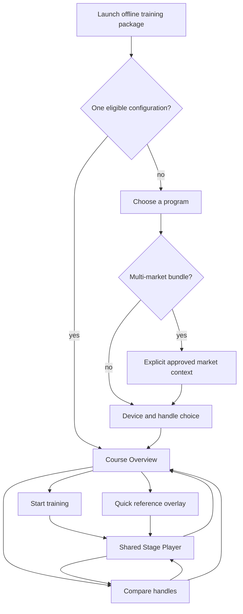

# Rapid Medical — Training App Screen Map v0.1
Date: 2026-11-05  |  Owner: UX/Product Design  |  Status: Low-fidelity concept

## Source and decision boundary
- Source: Rapid Medical (July 2026), *Tigertriever Training Webpage Content Draft v0.10* (FOR REVIEW). It specifies physicians, representative-led and independent learning, 10 narrative sections (Opening + eight procedural stages + Closing), and short on-screen copy with play/pause media.
- Source: Rapid Medical (October 2026), *Tiger Device Stages* developer wireframe: eight procedural stage labels, device/market/handle concepts, Tiger 13/17 first and 21/25 later.
- UX synthesis: *Final Research Synthesis v0.4*, *JTBD Map v0.1*, *MVP Definition v0.7*. The layout, adaptive entry, Quick Reference overlay and two-column Compare are **design hypotheses**, not clinical findings or signed deliverables.
- **No medical content is reproduced in this prototype.** Device names appear as conceptual labels; demo market and comparison pairing are fictional/testing only. The client supplies and approves all clinical/technical content, real eligibility and release scope.

## Learner screen map

## Screens and behavior

| ID | Screen/surface | Entry points | Main elements and states | Feature/JTBD trace |
|---|---|---|---|---|
| L01 | Package entry / configuration catalogue | Launch for multi-course package; Programs | Market selector only if multi-market, selectable exact configs, future model coverage, no device recommendation | FS-02; P01; P05 |
| L02 | Training Overview | Package single-course launch; catalogue selection; return | Exact context, Start, eight named stages with direct Open, framing Opening/Closing, Compare entry | FS-03; P01; P03; R01 |
| L03 | Stage Player | Start; stage card; Quick Reference | Persistent context, stage index, video placeholder + independent playback controls, adjacent approved copy placeholder, mandatory warning area, Prev/Next, Compare this stage | FS-04/05; P01; P03; P04; P05 |
| L04 | Quick Reference (overlay) | Main navigation; Overview; Player; Compare | Search the eight stage names, choose and open same Stage Player, preserve context; Esc closes; Cmd/Ctrl+K opens | FS-03; P03; R01 |
| L05 | Handle Compare | Overview; Stage Player | Same stage selector, two labeled complete instruction panels, independent media, missing paired-asset state, client-authored differences placeholder, Exit to origin | FS-06/07; P02; R02 |
| L06 | No eligible comparison (state) | Compare from a config lacking eligible pair | Explicit unavailability, no inferred pair/no substitution | FS-05/06; P05 |
| L07 | Test scenarios / Prototype notes | Prototype sidebar | Three formative tasks; definitions and limits; not production navigation | Research handoff |

## Stage information architecture
- Programme framing: Opening, followed by eight procedural stages, then Closing (framing materials optional until client confirms).
- Procedural stage labels inherited from the October client HTML concept (titles are not final clinical copy):
  1. Device preparation
  2. Positioning
  3. Deployment
  4. Optimising clot interaction
  5. Aspiration & combination technique
  6. Prepare to retrieve
  7. Retrieval
  8. Between passes
- No top-level tabs named Videos / Images / Files. Media is contextual to stage/program.
- “Stage 1 Tiger 13/17; Stage 2 Tiger 21/25” in client wireframe is understood as rollout phase, **not** clinical training stages.

## Content and data contract, conceptual
`PackageManifest → ApprovedMarket → ExactConfig(model, variant, handle) → Program → OrderedSection → ApprovedLessonRevision → ApprovedMedia`.
- Comparison pairs are *explicitly approved*, not inferred by matching strings; each side has its own media, text and warnings.
- A package may bypass selection screens only when its manifest has one eligible course.
- Offline learner never depends on Content Studio, network requests or unapproved fallbacks at runtime.
- Prototype does not implement this data contract or real offline packaging; it demonstrates navigation/UI only.

## Known design hypotheses to validate later
- One training surface supports both facilitated and solo learning without separate modes.
- Direct stage access as overlay is discoverable and more efficient than a separate Quick Reference page.
- Side-by-side Compare is comprehensible at desktop width and stacking adequate at narrow width.
- Users recognize exactly which handle/market they are seeing and understand missing comparison media.

## Deliberate exclusions for this learner prototype
- Content Studio, real approved video, IFU/medical text, model-versus-model spec comparison, interactive device simulation, automatic visual/video diff, offline ZIP release generator, actual hospital-browser compatibility test, and any certified medical training behavior.